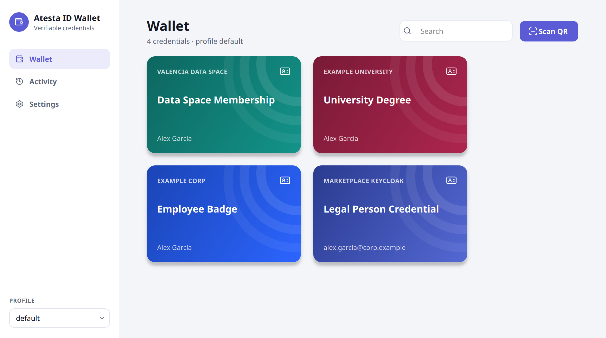
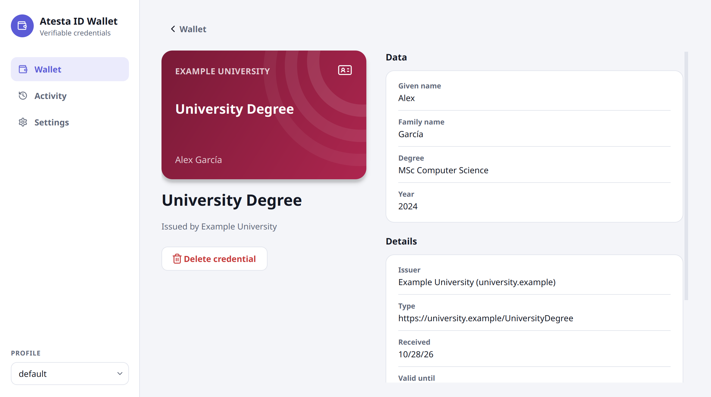

# Atesta ID Wallet

A desktop wallet for **verifiable credentials**. It receives credentials with
OpenID4VCI 1.0 and uses them to sign in with OpenID4VP 1.0, in SD-JWT VC format
(`dc+sd-jwt`). It replaces a phone wallet such as Lissi: you get credentials from
Keycloak and log in to verifiers (e.g. the CITCOM/VRAIN marketplace) from your laptop.

<picture>
  <source media="(prefers-color-scheme: dark)" srcset="docs/images/wallet-dark.png">
  
</picture>

It uses the protocols of the European Digital Identity (EUDI) wallets: OpenID4VCI, OpenID4VP and
SD-JWT VC. It is **not** a certified EUDI Wallet under eIDAS 2.0: that needs a provider notified
by a Member State, certification at assurance level high (with a secure hardware key store,
WSCD) and wallet attestations, which are out of scope for this prototype.

> **Status: prototype (TRL 5), version 0.8.0.** Tested against Keycloak and the CITCOM
> marketplace. Desktop window (Qt) and command line, in English, Spanish and Danish. Linux is the
> tested platform; the Windows builds are new and not yet tested by hand on real machines;
> macOS is untested. Read [docs/SECURITY.md](docs/SECURITY.md) before using it with real data.

## Install

Ready-made builds are on the [releases page](https://github.com/CitComAI-Hub/atesta-id-wallet/releases),
each with a `SHA256SUMS` file. They need no Python and no administrator rights (except the `.deb`).

| System | File | How |
|---|---|---|
| Windows 10/11 (x64) | `Atesta_ID_Wallet-X.Y.Z-windows-x64-setup.exe` | Run it. Installs for your user, adds a Start menu entry and opens the wallet links. |
| Windows, portable | `Atesta_ID_Wallet-X.Y.Z-windows-x64.zip` | Unzip and run `atesta-id-wallet-gui.exe`; register the links in *Settings → General*. |
| Debian, Ubuntu (22.04+) | `atesta-id-wallet_X.Y.Z_amd64.deb` | `sudo apt install ./atesta-id-wallet_X.Y.Z_amd64.deb` (with `dpkg -i`, run `sudo apt install -f` afterwards for the dependencies) |
| Any Linux (glibc 2.35+) | `Atesta_ID_Wallet-X.Y.Z-x86_64.AppImage` | `chmod +x` it and run it; register the links in *Settings → General*. `./Atesta_ID_Wallet-….AppImage cli …` runs the command line. |

To check a download: `sha256sum -c SHA256SUMS --ignore-missing` (Linux) or
`Get-FileHash FILE` (PowerShell) and compare with `SHA256SUMS`. The Windows builds are not
code-signed yet, so SmartScreen shows a warning (*More info → Run anyway*).

Updating: install the new version over the old one; your data is kept. *Settings → About*
can check for new versions (off by default) and `atesta-id-wallet update` does it from the terminal.
Uninstall: Windows *Settings → Apps*; `sudo apt remove atesta-id-wallet`; delete the AppImage. The
wallet data (see [Data](#data)) is never deleted by uninstalling.

### From source: Linux

```bash
sudo apt install python3-venv wl-clipboard   # wl-clipboard (or xclip): read links from the clipboard
./install.sh
```

This installs the **Atesta ID Wallet** application (menu entry and `atesta-id-wallet-gui`) and the
`atesta-id-wallet` command in `~/.local/bin`, without sudo. It also registers the wallet as the
handler for `openid-credential-offer://` and `openid4vp://` links. Use `./install.sh --no-gui`
for the command line only (saves ~250 MB of Qt); links then open in a terminal.

| Task | Command |
|---|---|
| Update (git pull + reinstall) | `atesta-id-wallet update` or `./install.sh --update` |
| Uninstall, keep your data | `./install.sh --uninstall` |
| Uninstall and delete all data | `./install.sh --uninstall --purge` |

`pipx install ".[gui]"` also works; run `atesta-id-wallet install-handler` afterwards.

### From source: Windows

Install Python 3.10+ from python.org, then in a terminal:

```powershell
py -m pip install --user pipx; py -m pipx ensurepath   # once; open a new terminal afterwards
pipx install ".[gui]"
atesta-id-wallet install-handler    # registers the links for your user (HKCU), no admin rights
```

Data lives in `%APPDATA%\atesta-id-wallet` unless `ATESTA_ID_WALLET_HOME` is set.
Screenshots are looked up in `Pictures\Screenshots` (also under OneDrive), and the clipboard is
read for both links and images (Win+Shift+S).

### From source: macOS

`pipx install ".[gui]"` works and reads QR codes from the clipboard and from screenshots on the
Desktop. Opening `openid4vp://` links directly needs a packaged `.app`, which is not available yet.

## Which interface starts

| You… | What opens |
|---|---|
| open **Atesta ID Wallet** from the applications menu | the window |
| click an `openid4vp://` or `openid-credential-offer://` link | the window (the terminal with `--no-gui` installs) |
| run `atesta-id-wallet-gui` | the window |
| run `atesta-id-wallet` | the terminal version |

Only one window runs at a time: a link clicked while the wallet is open goes to that window.

## Usage

Open **Atesta ID Wallet** from the applications menu. Your credentials appear as cards in
**Wallet**. **Activity** shows what you received and what you shared with whom, and
**Settings** holds the language, profiles, security (wallet password), backups and verifier trust.



**1. Add a credential.** In your Keycloak account, open *Verifiable Credentials → Issue to wallet*.
If you see a link, click it and the wallet opens. If you see a QR code, press **Scan QR** and
take a screenshot (Print Screen, or Win+Shift+S on Windows). The wallet detects the QR by itself.

The wallet first shows who is offering which credential, and warns you if you have never used
that issuer before. After you accept, it asks for your Keycloak username and password together.
It remembers the username but never stores the password, and only sends the password over HTTPS
to the authorization server's own domain. It checks the credential's signature and key binding
before storing it, and shows it with the name and colours the issuer publishes.

**2. Sign in to a verifier.** Click the login link, or press **Scan QR** and take a screenshot
of the login QR code. Before anything is sent, the wallet shows:

- who is asking, and how far its identity could be verified (green, amber or red);
- where the data will be sent;
- exactly which claims will be disclosed.

Nothing is sent until you press **Share**. For a verifier whose certificate changed or cannot
be verified, you must also tick *I understand the risk*. If several credentials match, the wallet
asks which one to use. Shared and declined requests are recorded in **Activity**. The browser
then completes the login.

**Scan QR** checks the clipboard and any screenshot taken in the last 5 minutes. If it finds
nothing, it keeps watching until a QR appears. **Open image…** and **Paste link…** cover the rest.

### Command line

Everything is also available from the terminal. With no arguments, `atesta-id-wallet` looks for
input like the **Scan QR** button does, and then asks you to paste a link:

```bash
atesta-id-wallet 'openid4vp://?client_id=...&request_uri=...'
atesta-id-wallet ~/Pictures/Screenshots/screenshot.png
atesta-id-wallet --verbose present --dry-run --qr-image screenshot.png   # debug without sending
```

In the terminal, consent is a `[y/N]` question showing the same information.

## Language

The interface is available in **English**, **Spanish** and **Danish**. By default it follows the
system language and falls back to English. To choose one by hand, go to *Settings → General →
Language* in the window, or use the command line:

```bash
atesta-id-wallet language        # show the current language and setting
atesta-id-wallet language da     # auto | en | es | da
```

The choice is shared by all profiles (`settings.json` in the data folder). Issuer names and
credential names are shown in the interface language when the issuer publishes them in it.

Translations live in `atesta_id_wallet/i18n/<code>.json`. The English text in the code is the
source and the fallback. A test checks that every catalog has all the strings, with the same
`{placeholders}`. To add a language, copy `es.json`, translate the values and add the code to
`LANGUAGES` in `atesta_id_wallet/i18n/__init__.py`.

## Managing credentials and identities

```bash
atesta-id-wallet list [-d]              # stored credentials (-d: all claims)
atesta-id-wallet history                # what was received, shared or declined, and with whom
atesta-id-wallet remove 2               # delete by number or id from 'list'
atesta-id-wallet backup ~/wallet.bak    # encrypted backup of the profile, holder key included
atesta-id-wallet restore ~/wallet.bak   # into an empty profile
atesta-id-wallet reset                  # delete key, credentials and settings of the profile
atesta-id-wallet password [set|remove]  # wallet password: app lock (see Data)
```

**Profiles** keep separate identities, for example personal, work or testing. Each profile has
its own holder key, credentials, history and settings:

```bash
atesta-id-wallet profiles add work
atesta-id-wallet --profile work issue      # or ATESTA_ID_WALLET_PROFILE=work
atesta-id-wallet profiles                  # list
atesta-id-wallet profiles remove work
```

In the window, the active profile is chosen at the bottom of the sidebar or in *Settings →
Profile*, and the window opens with the last one you used. In the terminal, when more than one
profile exists and none is given, `issue` and `present` ask which one to use.

## Verifier trust

```bash
atesta-id-wallet trust                     # trusted CAs and remembered verifiers
atesta-id-wallet trust add-ca ca.pem       # trust verifiers whose certificate chains to this CA
atesta-id-wallet trust forget x509_san_dns:verifier.example
```

Without a trusted CA, the wallet works like SSH and trusts a verifier on first use. It pins the
verifier's certificate after the first successful login and warns loudly if the certificate
changes. See [docs/SECURITY.md](docs/SECURITY.md).

## Useful options

- `issue --browser-login`: log in to Keycloak in the browser instead of the wallet. You need
  this when Keycloak uses an external IdP, WebAuthn, etc.
- `issue --client-id ID --redirect-uri http://localhost:8765/callback`: use a dedicated OAuth
  client registered for wallets. The wallet captures the code automatically.
- `present --disclose-all`: disclose every claim, not only the requested ones.
- `present --yes`: skip the confirmation. Refused for verifiers whose identity cannot be verified.
- `present --allow-unverified`: accept unsigned requests. Confirmation is still required.
- `present --vp-token-style string`: for verifiers that implement older OpenID4VP drafts.
- `--verbose`: protocol details (in the window: *Settings → Advanced → Protocol details*).

## Data

Stored in `~/.local/share/atesta-id-wallet/` on Linux, `%APPDATA%\atesta-id-wallet` on Windows and
`~/Library/Application Support/atesta-id-wallet` on macOS (or `$ATESTA_ID_WALLET_HOME`).
Each profile (`default` and the ones you create) is a folder `profiles/<name>/` with the files
below; `settings.json` is in the root. Directories are `0700` and files `0600`.

Everything in a profile is **encrypted** (AES-256-GCM) with a key of that profile. The key is in
the system keyring (GNOME Keyring/KWallet, Windows Credential Manager), so the wallet opens with
your session. A **wallet password** (*Settings → Security* or `atesta-id-wallet password set`)
takes the key out of the keyring and locks the wallet: it is asked for when the wallet opens and
after 5 minutes without use. Without a keyring the wallet asks you to choose one. The password
cannot be recovered: keep a backup. Details in [docs/SECURITY.md](docs/SECURITY.md).

| File in `profiles/<name>/` | Contents |
|---|---|
| `holder_key.enc` | Wallet private key (P-256). Your credentials are bound to it: **back it up** (`backup`) and never share it. |
| `credentials/*.enc` | Received SD-JWT credentials, with the issuer's display name and colours. |
| `config.enc` | Per issuer: username, `client_id` and `redirect_uri` that worked. Pinned verifier certificates. |
| `history.enc` | Activity: credentials received, data shared or declined, and with whom. |
| `trusted_cas/*.pem` | CAs whose verifiers are trusted (public certificates, not encrypted). |
| `vault.json` | How the profile key is kept: in the keyring, or wrapped with the wallet password. |
| `settings.json` (root) | Application settings shared by all profiles (language, last profile, new-version check). |

## Limitations

- SD-JWT VC only (`dc+sd-jwt` / `vc+sd-jwt`). No `jwt_vc_json`, mso_mdoc or deferred issuance.
- Verifier client_id schemes: `x509_san_dns`, `x509_hash` and `redirect_uri` (the last one only
  with `--allow-unverified`). DIDs, verifier attestations and OpenID Federation are not supported.
- Supported `response_mode` values: `direct_post` and `direct_post.jwt` (ECDH-ES + AES-GCM).
  No Digital Credentials API (browser-mediated) flows.
- DCQL: `credentials`, `credential_sets`, `claims` (with `values`) and `claim_sets`;
  `trusted_authorities` and `multiple` are ignored.
- Keys are software keys (no TPM or secure element). See [docs/SECURITY.md](docs/SECURITY.md).
- One holder key per profile, so verifiers can correlate presentations made with the same profile.
- No revocation check (Token Status List).

## Architecture

| Module | Responsibility |
|---|---|
| `common` | Errors, messages, base64url/JWT/JSON helpers, HTTP helpers |
| `i18n` | `tr()` / `tr_n()` translations with English fallback; `es.json`, `da.json` catalogs |
| `jose` | JWS verification, JWK/X.509 keys, JWE encryption of responses |
| `sdjwt` | SD-JWT VC parsing (strict) and disclosure selection |
| `storage` | Profiles, holder key, credentials, history, settings and trusted CAs on disk (encrypted, atomic writes) |
| `vault` | Profile encryption: data key in the system keyring or wrapped with the wallet password |
| `trust` | Verifier identity and trust (x509_san_dns, x509_hash, pinning, CAs) |
| `vci` | OpenID4VCI: offers, metadata checks, authorization server login, issuance, issuer signature |
| `vp` | OpenID4VP: request, DCQL / Presentation Exchange, `prepare_presentation` → `build_response` → `send_presentation` |
| `desktop` | Clipboard, screenshots with QR codes, link handler (also for the packaged executables) |
| `updates` | New-version check against GitHub Releases (only when asked or enabled) |
| `ui` | `Prompter` interface: everything the flows ask the user; terminal implementation |
| `cli` | Command line |
| `gui` | Qt window (`app`: window, worker thread and single-instance socket; `pages`; `sheets` for flow panels; `widgets`; `theme` with light and dark palettes) |

Protocol modules (`vci`, `vp`) never talk to the user directly: they receive a `ui.Prompter`.
The terminal and the GUI implement it, so both run exactly the same flows.

## Development

```bash
python3 -m venv .venv && .venv/bin/pip install -e ".[gui]"
QT_QPA_PLATFORM=offscreen .venv/bin/python -m unittest discover -s tests
```

The tests run offline (about 100 tests, a few seconds). They use local fake Keycloak, issuer and
verifier servers, and drive the GUI headless. The GUI tests are skipped if PySide6 is not
installed. `tests/test_offline.py` covers the flows end to end; `tests/test_hardening.py` holds
the regression tests for the security review of 0.5.1; `tests/test_packaging.py` covers the
packaged executables and the new-version check; `tests/test_vault.py` the encryption and the lock. Test messages are checked in Spanish, so
the Spanish catalog is exercised too.

The README screenshots are generated with made-up data by `python docs/make_screenshots.py`
(run it again when the interface changes).

Builds and releases: [docs/RELEASING.md](docs/RELEASING.md). Manual checks on Windows:
[docs/TESTING-WINDOWS.md](docs/TESTING-WINDOWS.md).

Code, comments and documentation are in English; user-facing text is English in the code and
translated through the catalogs (Spanish, Danish).

## Credits

Icons from [Lucide](https://lucide.dev) (ISC license, see `atesta_id_wallet/gui/icons/LICENSE`).
